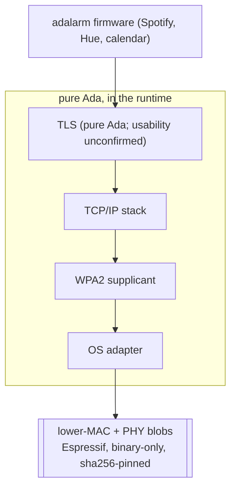
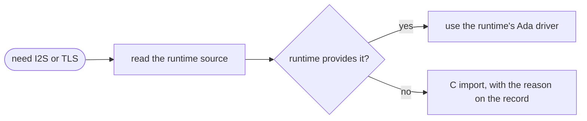

# The ada_esp32s3 Bare-Metal Runtime

The firmware builds on [rowsail/ada_esp32s3](https://github.com/rowsail/ada_esp32s3), a from-scratch Ada runtime for the ESP32-S3, rather than on ESP-IDF/FreeRTOS bindings.
This page describes what the runtime is and what it does and does not provide, and is rewritten as the runtime moves.

## What It Provides

The runtime implements its own context switch, interrupt vectors, SMP scheduler, and inter-core IPI, all in Ada plus Xtensa assembly.
FreeRTOS is never linked.
The build is Alire-based on the `gnat_xtensa_esp32_elf` toolchain.
VS Code build tasks and on-chip GDB over USB-Serial-JTAG are already set up.

## WiFi and the Binary Blobs

WiFi links Espressif's binary-only lower-MAC and PHY blobs, fetched and sha256-pinned via Espressif's tooling rather than committed to this repo.
Everything above that layer, the OS adapter, the WPA2 supplicant, the TCP/IP stack, and TLS, is pure Ada in the runtime's stack.

## Known Gaps

- No Ada drivers exist for the 1602 LCD / PCF8574 backpack, the Seesaw encoder, or I2S output. All three are written from scratch as part of this project.
- Whether the runtime already provides an I2S peripheral driver is unconfirmed. Read the runtime source before writing one from scratch.
- Whether the runtime's TCP/IP stack has usable TLS, sufficient for Spotify's HTTPS API, is unconfirmed. Verify before relying on it.

The two unconfirmed pieces, I2S and TLS, are resolved the same way, and they are the only places the firmware may import C:

Every other driver (LCD, encoder) is pure Ada regardless.

## Maturity

The runtime is alpha quality.
Expect to read its source directly rather than rely on documentation, and expect gaps: missing peripheral drivers, and possible linker issues per the project's own notes.
