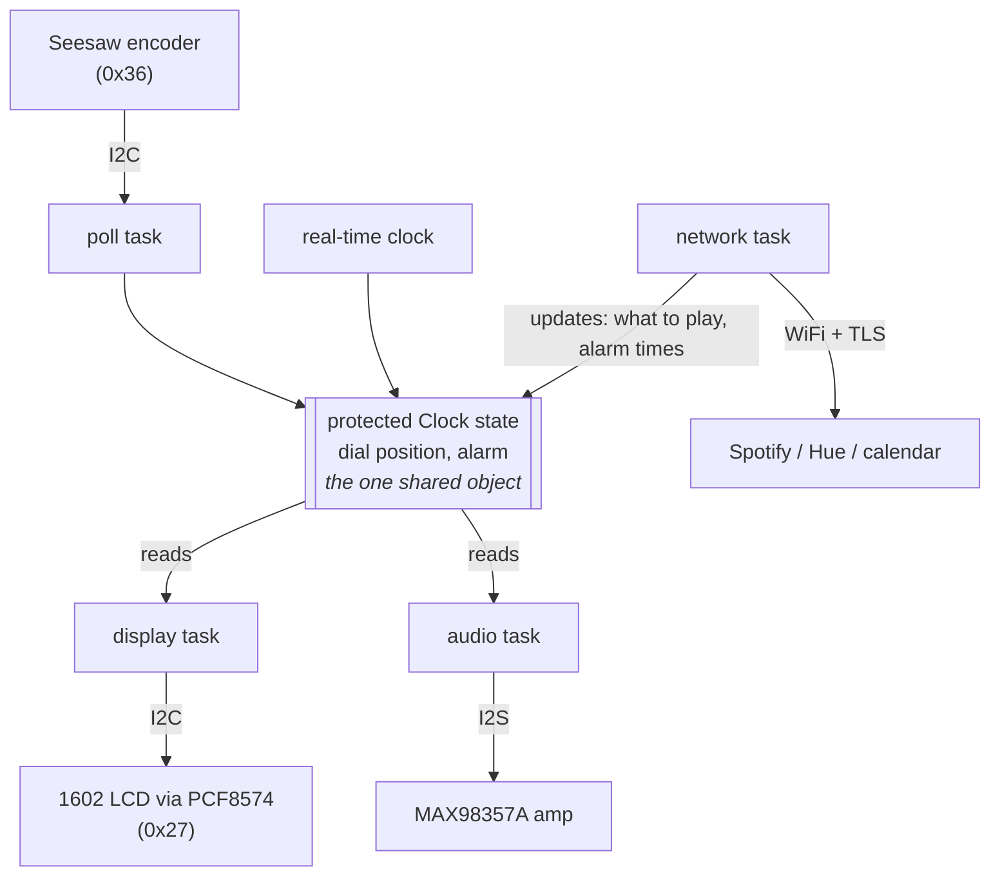

# The Clock as a System

The firmware is a small set of concurrent tasks over a shared state, running directly on a
bare-metal Ada runtime with no operating system underneath.
Input from a dial and a real-time clock drives a state machine; the state machine drives a character
display and an audio amplifier; a network stack feeds it what to play.
This page describes each part and the data that crosses between them, so that "the dial" or "the
alarm state" means one thing everywhere.

The one idea to hold onto is that the interesting concurrency lives in Ada, not in a C RTOS.
There is no FreeRTOS task, queue, or mutex here; tasks are Ada tasks and shared state is an Ada
protected object, scheduled by the runtime's own Ravenscar scheduler.
The firmware targets the `ada_esp32s3` bare-metal runtime and never links ESP-IDF or FreeRTOS;
what that runtime provides and lacks is [`ada-runtime.md`](ada-runtime.md).

## The Shape

The pinout and addresses on this diagram are those of the reference build; [`hardware.md`](hardware.md)
holds every GPIO and I2C address, and changes with the parts ([`bom.md`](bom.md)).

## The Shared State and the Tasks Around It

The center of the design is one **protected object** holding the live state: the dial's current
position and the alarm's state machine.
A protected object is Ada's guarded shared-state primitive: its operations run with mutual exclusion
provided by the runtime, so many tasks can touch the state without a lock in the application code.
This is the Ravenscar dial pattern:

- The **poll task** reads the encoder over I2C and writes the new dial position into the protected
  object.
- The **display task** reads the protected object and renders it to the LCD.
- The **audio task** reads whether the alarm is ringing and drives the I2S stream accordingly.
- The **network task** talks to Spotify and the other services and updates what the clock should
  play and when it should ring.

Keeping the mutable state in one protected object, rather than scattered across tasks, is what makes
the concurrency tractable: there is exactly one place a race could happen, and the runtime closes it.

## What Crosses Each Boundary

**Encoder to state (the poll task).**
Input is I2C reads from the Seesaw at `0x36`: an accumulated step count and a button state.
Output is a dial position and button events written into the protected object.
The encoder knows nothing about what the dial controls.

**State to display (the display task).**
Input is the protected state (time, dial position, alarm state).
Output is 4-bit nibble sequences to the PCF8574 at `0x27`, which drives the 1602 LCD.
Pure rendering; it does not change state.

**State to audio (the audio task).**
Input is whether the alarm is ringing.
Output is a raw I2S bitstream to the MAX98357A.

**Network to state (the network task).**
Input is HTTPS responses from Spotify and the other services.
Output is updates to the protected state: what device is active, what to play, alarm and calendar
times.

## The Alarm State Machine

At the heart of the shared state is the alarm's state machine: a small enumerated state (Idle,
Ringing, Snoozed, Suppressed by calendar) with a total transition function over a fixed set of
events.
It is pure logic with no hardware dependency, so it is built and tested on the development machine
before any board exists, and it is the place Ada's contracts do the most work: an illegal transition
is a checked error under `-gnata`, not a bug discovered at 6am.

## The Runtime and the Ada/C Boundary

Underneath all of this is the `ada_esp32s3` runtime: its own context switch, interrupt vectors, SMP
scheduler, and inter-core IPI, all in Ada plus Xtensa assembly, with no FreeRTOS linked.
WiFi links Espressif's binary-only lower-MAC and PHY blobs; everything above that (the OS adapter,
the WPA2 supplicant, the TCP/IP stack, and TLS) is pure Ada in the runtime.
What the runtime supplies and where it has gaps is [`ada-runtime.md`](ada-runtime.md).

The firmware is pure Ada by default.
Two components on the critical path, I2S output and TLS, may fall back to a C import if the runtime
turns out not to provide them; those are the only two places a C import is allowed.
The design keeps target-specific code confined to the drivers, so the state machine and the
application logic stay portable and host-testable.
